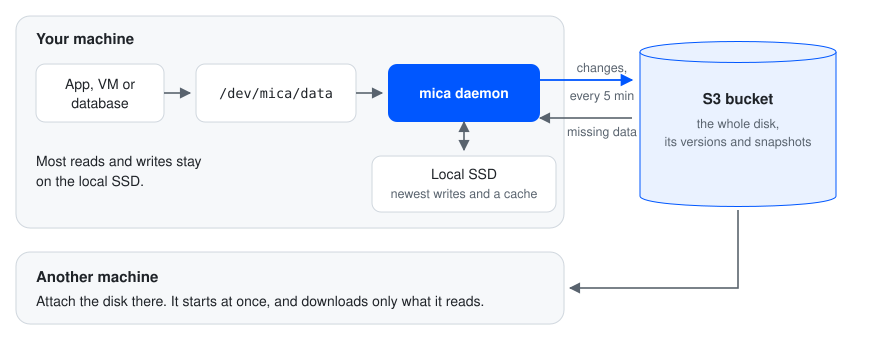

<p align="center"></p>

<p align="center"><strong>A Linux disk that lives in an S3 bucket.</strong><br>It can be larger than your SSD, and it moves to any machine.</p>

<p align="center"><a href="docs/getting-started.md">Get started</a> · <a href="docs/design.md">How it works</a> · <a href="docs/benchmarks.md">Speed and cost</a> · <a href="docs/README.md">All docs</a></p>

<br>

mica gives a Linux machine a normal disk, `/dev/mica/<name>`. Put a filesystem on it, give it to a VM, or keep a database on it. The whole disk lives in an S3 bucket, such as Cloudflare R2 or AWS S3. The machine keeps the newest writes and a cache on its local SSD, so most reads and writes do not wait for the bucket.

<p align="center">
  <picture>
    <source media="(prefers-color-scheme: dark)" srcset="assets/how-it-works-dark.svg">
    
  </picture>
</p>

## What you can do with it

- **Move a disk to another machine.** Detach it here and attach it there. The other machine starts at once and downloads only the data that it reads.
- **Keep old versions.** A snapshot is a name for a version, and copies nothing. A restore makes a new disk from it inside the bucket, so nothing downloads.
- **Keep VM and database data off the machine.** The VM boots from a small local disk and keeps its data on a mica disk. When the machine is lost, the disk stays in the bucket as of its last save.
- **Give a laptop a terabyte.** The disk is a line in `/etc/fstab`. It mounts at each boot, and you use it with no sudo.

## See it work

```console
$ sudo mica disk create photos --size 1T --chunk-size 4M --store s3.toml
✔ Made disk photos: 1T in chunks of 4M
  Attach it: sudo mica disk attach photos

$ sudo mica disk attach photos
✔ Attached disk photos as /dev/mica/photos
  The disk is new. Make a filesystem on it once: sudo mkfs.ext4 /dev/mica/photos

$ sudo mica status
DISK    DEVICE            READ  WRITE   UPLOAD  DOWNLOAD  UNSAVED    CACHE        LAST SAVE  STATE
photos  /dev/mica/photos  -     160M/s  91M/s   -         2.4G / 4G  512M / 512M  47 s ago   ok

$ sudo mica disk detach photos
⠒ Uploading photos  ━━━━━━━━━━━━━━━───────── 1.2G / 1.9G  91M/s  8s left
✔ Detached disk photos. The bucket has all its data, so any machine can attach it
```

You give the bucket and its keys once. After that, each command needs only the name of the disk.

## How it works, in one minute

1. The disk is a row of chunks, 1 MiB each by default. Writes go to the local SSD first.
2. Every 5 minutes, mica uploads the chunks that changed. Then it writes one small object, the **head**, that names the new version.
3. The head is also the lock. mica writes it with an S3 conditional write, so a second machine cannot take a disk that is in use.

[How mica works](docs/design.md) explains each step, snapshots, the crash rules and the layout in the bucket.

## Speed and cost

| | Result in the lab |
|---|---|
| Database reads, cold cache, 20 ms to the bucket | As fast as a local file |
| Database writes with many flushes | 40 to 50 % of a local file |
| A quiet 50 GB disk on Cloudflare R2 | About $0.60 a month |
| A database that writes all day, on R2 | $1 to $13 a month when its data fits in memory, about $25 when it does not |
| Power cuts and crashes of the daemon | No flushed write lost in 10 of 10 tests |

[Speed and cost](docs/benchmarks.md) has the setup, all the numbers and the prices of each provider.

## Before you use it

- **You need** Linux 6.16 or later with the `ublk_drv` module, systemd, and an S3 bucket with conditional writes, such as Cloudflare R2, AWS S3, MinIO or RustFS. mica uses ublk, not FUSE.
- **Changes reach the bucket every 5 minutes.** A crash or a reboot loses no flushed write. But when a machine is lost for good, so are its changes since the last save.
- **One machine at a time** uses a disk. Other machines can read a copy made from a snapshot.

[Get started](docs/getting-started.md) shows the install, step by step.

## Documentation

| Page | Read it to |
|---|---|
| [Get started](docs/getting-started.md) | Install mica, make a first disk, and move it to another machine |
| [Use mica](docs/usage.md) | Use buckets, VMs, laptops, snapshots, limits and every command |
| [Fix a problem](docs/troubleshooting.md) | Find what a message means and what to do |
| [How mica works](docs/design.md) | Learn the design: writes, reads, the lock, snapshots, crashes |
| [Speed and cost](docs/benchmarks.md) | See the measurements and the monthly cost |
| [The daemon API](docs/api.md) | Control mica from another program |
| [The lab](lab/README.md) | Run the tests and benchmarks yourself |

## Status

mica is under development. Do not use it yet for data that you cannot lose.

## License

MIT. See [LICENSE](LICENSE).
