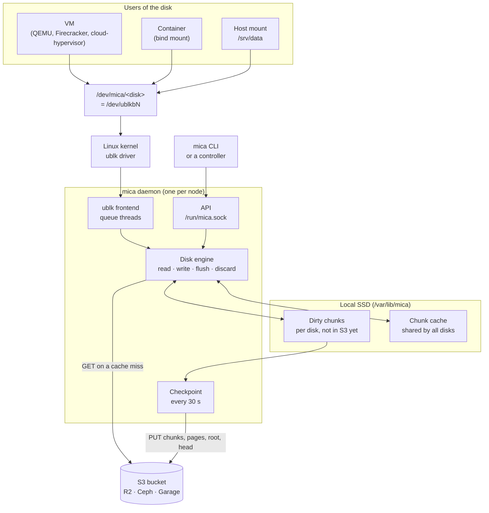
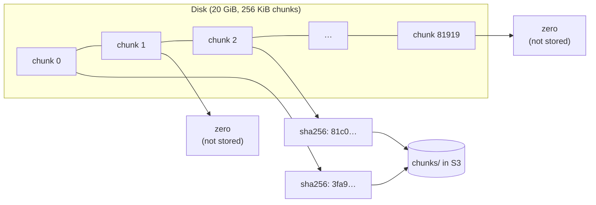
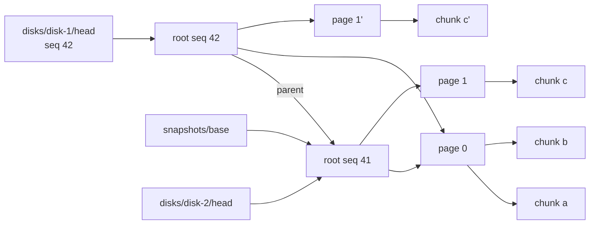
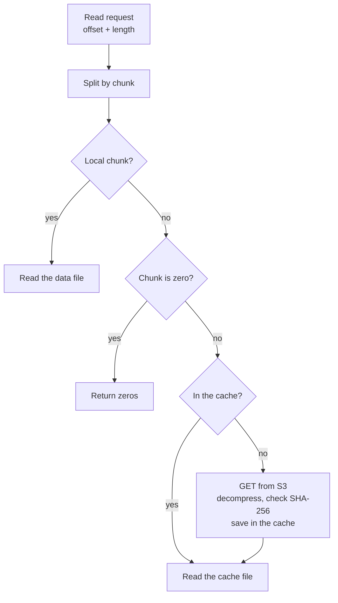
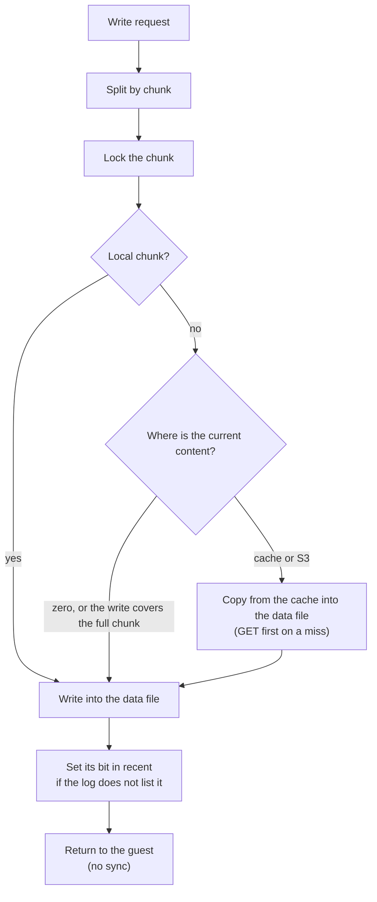
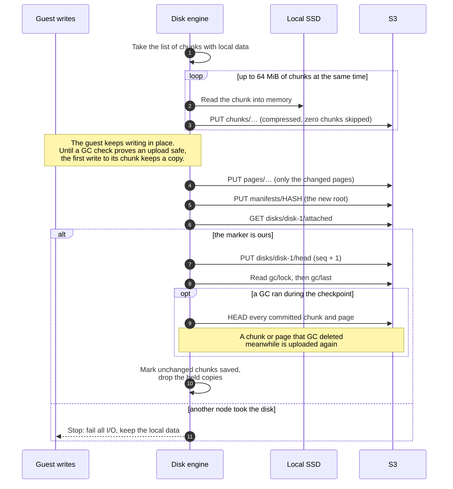
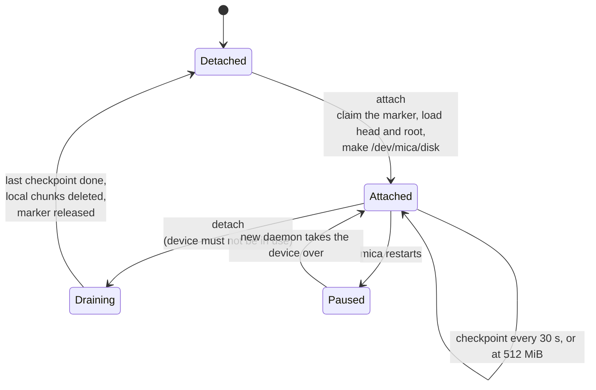
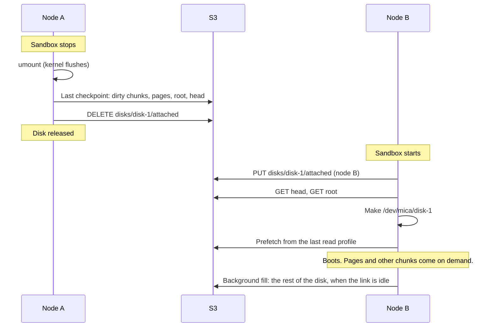
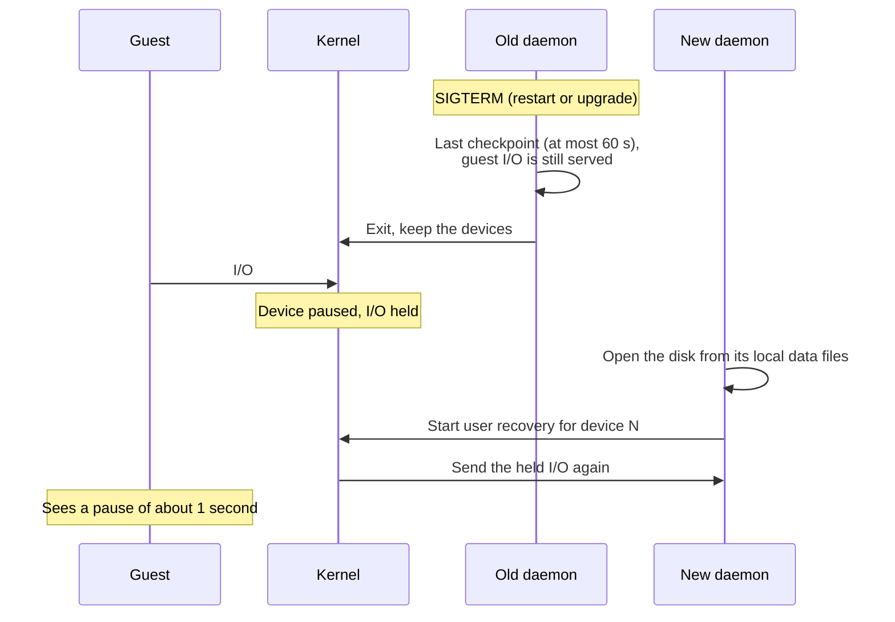
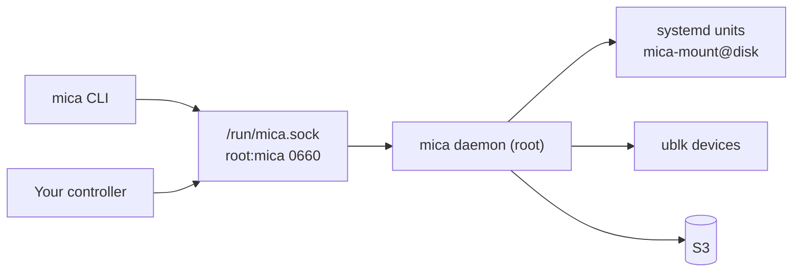

# Architecture

This page explains how mica works, from a write in a guest to an object in S3. For the reasons behind each choice, see [design.md](design.md). For what happens when something fails, see [reliability.md](reliability.md).

## The big picture

mica turns an S3 bucket into block devices. A node attaches a disk and gets `/dev/mica/<disk>`. A VM, a container or the host uses it like any other disk.



Three rules shape everything else:

1. **Writes go to the local SSD first.** The guest never waits for S3 on a write or a flush.
2. **A read never waits for data that it does not need.** Nothing is copied before the disk is ready. Prefetch and the background fill run behind the reads.
3. **A background checkpoint uploads changes** every 30 s, or earlier when much data waits. After a detach, S3 has everything, and the disk can attach on any other node.

## Chunks

mica splits every disk into **chunks** of one size. The size is set when the disk is made: 64 KiB to 4 MiB, 256 KiB by default. A 100 GiB disk of 256 KiB chunks has 409,600 chunks.

A small chunk makes a cold read cheap: a 4 KiB read downloads 256 KiB, not 4 MiB. A large chunk needs fewer S3 requests for the same data.

In S3, a chunk is an immutable object. Its key is the SHA-256 of its content. Thus:

- Two equal chunks are one object. An image and all the disks made from it share their chunks.
- mica checks every downloaded chunk against its key. A corrupt chunk is rejected.
- An all-zero chunk is never stored.
- A chunk is stored as a zstd frame. The key is the hash of the plain data, so equal chunks still share one object.



A disk is **thin**. `create` stores no chunks. A chunk uses space only after the guest writes to it, wherever the write lands.

## What is in S3

```text
chunks/<first 2 hex>/<chunk hash>   one chunk, compressed, immutable
pages/<first 2 hex>/<page hash>     the hashes of 1,024 chunks, compressed, immutable
manifests/<root hash>               the root of one disk at one moment: one hash per page, immutable
disks/<disk>/head                   which root is current, overwritten on each commit
disks/<disk>/attached               which node owns the disk, only while attached
snapshots/<name>                    a named root
gc/lock                             only while a GC runs
gc/last                             the last GC that deleted objects
```



- **A page** lists the hashes of 1,024 chunks: 32 KiB. With 256 KiB chunks, one page covers 256 MiB of the disk. A page of zero chunks is not stored.
- **A root** (the object under `manifests/`) lists the hashes of all pages of a disk: 12.5 KiB for 100 GiB. It is a full list, not a change list, so one root describes the full disk.
- Pages are immutable, and their key is their hash. A commit writes only the pages it changes. Commits, snapshots and clones share all other pages.
- **The head** points to the current root, and holds the read profile (see [Fast boot](#fast-boot)).
- **A snapshot** is a pointer to a root. It copies no data.
- **A disk made from a snapshot** starts with a head that points to the snapshot's root. It shares every page and chunk until it writes.

## What is on the local SSD

```text
/var/lib/mica/
  node-id                      random ID of this node
  cache/<xx>/<chunk hash>      clean chunks, not compressed; S3 has all of them
  pages/<xx>/<page hash>       pages; S3 has all of them
/run/mica/sessions/<data dir>/<disk>.recent
                               bitmap of chunks that became local since their last FLUSH
  disks/<disk>/
    state                      attached or orphaned, and the ublk device number
    dirty/data-<n>             sparse data files: the disk's local chunks, at their disk offset
    dirty/log-a, dirty/log-b   the dirty log: which chunks are local
    dirty/hold                 old content of chunks that a checkpoint uploads now
```

**Local chunks** live in the data files, one file per GiB of the disk, at the chunk's offset in the disk. The guest writes them in place. A local chunk is **unsaved** until a checkpoint uploads it, then **saved**. A saved chunk stays local, so the guest can write it again at once. Unsaved chunks are the only local data that S3 does not have. mica never frees one before a commit includes it.

**The dirty log** lists the local chunks. After a power loss, only listed chunks are local; mica punches out every other range of the data files. Two files are used in turn: a rewrite goes to the file not in use and is synced before it counts, so one of the two is always whole. **`recent`** is a bitmap of the chunks that became local since their last FLUSH: one bit per chunk, in `/run`, mapped into memory. Setting a bit is one memory store. `/run` is a tmpfs, so the bitmap survives a crash of mica, as the page cache does, and a reboot clears it, as it clears the page cache.

**The cache** holds clean chunks. Any of them can go, because S3 has them all. The cache evicts the least recently used chunks at its limit (50 GiB by default), and `mica cache prune` removes chunks that no attached disk uses. A saved chunk goes into the cache when it leaves the data files: when local data passes `dirty_limit_gib`, and at detach.

A download is written to the cache without a sync, so a read does not wait for the SSD. After a crash, a cache file can be torn. So mica checks the hash of each cache file that it finds at start, before the first read from it.

**Pages load on first use.** An attach reads only the head and the root. mica loads a page, and makes the state of its 1,024 chunks, when the guest first uses that part of the disk. Thus a large disk costs memory only for the parts that the guest uses.

## The read path



When many requests miss the same chunk, mica sends one GET.

When the guest reads in sequence, mica fetches the next chunks before the guest asks for them. This **read-ahead** starts with 1 MiB ahead of the reader, and doubles up to 8 MiB.

## The write path



- The copy uses `copy_file_range`. On XFS and btrfs this is a reflink and costs no I/O. On other filesystems it is a copy.
- A zero chunk needs no copy: every range that is not local is a hole.
- A chunk is listed only after its data is in the data file. Thus no list names a chunk whose range holds something other than its content.
- The chunk lock is held until the data is in the file. Thus a checkpoint cannot read a chunk while a write goes into it.
- No write makes, renames or deletes a file.

## Where a request runs

Each device has one queue thread per CPU, up to 4. A queue thread first tries to serve a request by itself:

- **A read** whose chunks are all local (a dirty chunk, a cached chunk or zeros) is read with io_uring straight into the request buffer.
- **A write** into local chunks is written with io_uring.

This needs no lock wait, no S3 and no other thread. Anything else goes to the disk engine on tokio: a chunk that is not local yet, a busy lock, a full local disk, a chunk that needs a held copy (see [Checkpoint](#checkpoint)), FUA writes, discards and flushes. A FUA write is a write and a FLUSH: every sync of a data file goes through FLUSH, one at a time, so a failed sync stops the disk before any later sync can report success.

## Flush

The device tells the kernel that it has a volatile write cache. So filesystems send FLUSH when they need durability (`fsync`, journal commits, `umount`).

On FLUSH, mica syncs the data files written since the last FLUSH, at the same time. Then it appends the chunks that became local to the dirty log, and syncs the log. The order matters: the log never lists a chunk whose data a power loss could lose. Most FLUSHes are one `fdatasync`. mica starts writeback after each 16 MiB of writes, so a FLUSH after a large write finds little left to write. One FLUSH runs at a time, and a FLUSH that finds its writes durable already returns at once. **A flush never touches S3.** When a flush returns, the data survives a crash of mica or a reboot of the node.

A write that returned survives a crash of mica even before a FLUSH: the page cache keeps it, and `recent` tells the next daemon which chunks it touched.

## Discard

- A discard of a **whole chunk** turns it into zeros. The checkpoint then stores it as a zero chunk: nothing to upload, nothing to store.
- A discard of **part of a chunk** is ignored. A discard is only a hint, and honoring it would download and upload the chunk again.
- The device reports a discard granularity of one chunk, so trims arrive as whole chunks.
- `mica disk unmount` runs `fstrim` before it unmounts. So space that deleted files freed is never uploaded.

## Checkpoint

A checkpoint moves dirty chunks to S3 and commits a new root. It runs 30 s after the last one started while a disk has dirty chunks. It starts early when 512 MiB of local data waits, or when local space runs low. It also runs at detach, at snapshot, and on `mica disk checkpoint`. An idle disk makes no S3 requests.

Thus, a guest that writes much data has its uploads run while it writes, and a detach has little left to upload.



- The list of chunks is taken at the start. Chunks that the guest changes later go to the next checkpoint. So a busy writer cannot make a checkpoint last forever.
- A chunk that the guest writes many times, such as the filesystem journal, goes up at most once per checkpoint.
- When the guest changes no chunk, the root stays. Only the head is written, with the new read profile.
- **Held copies.** GC can delete an upload only if a GC runs when the PUT ends: GC checks an object's age just before it deletes it, and the PUT makes the age new. So during the upload, mica checks GC state once a second. An upload that ended before a check that finds no GC is safe. Until then, the first guest write to its chunk keeps the uploaded content: in memory up to 64 MiB, then in the `hold` file. If a GC ran, the repair uploads a deleted chunk again from that copy.

## Attach and detach



**Attach**

1. Claim the `attached` marker. If another node holds it, stop. `--force` takes it, and is only for a node that is down.
   - With `s3.conditional_writes`, the claim is one atomic create (`PUT` with `If-None-Match: *`). Of two nodes that claim at the same moment, only one can create the marker.
   - Without it, mica writes the marker with a random claim ID, waits 1 s, and reads it back. The node that finds another claim ID stops.
2. Read the head, then the root. Without conditional writes, this runs during the 1 s wait.
3. Add any local chunks left by a crash.
4. Make the ublk device and the link `/dev/mica/<disk>`.
5. Start the checkpoint loop, a watcher that reads the marker every minute, and the prefetch (see [Fast boot](#fast-boot)).

Each disk has its own attach lock, so different disks attach at the same time. Two attaches of the same disk wait for each other and get the same device. With conditional writes, an attach takes about 25 ms on a link with 1 ms round trip.

**Detach** always waits. When it returns, S3 has all the data and the disk is free.

1. Refuse if the device is open or mounted.
2. Remove the device.
3. Run checkpoints until one succeeds.
4. Delete the local chunks, then the marker, then the disk folder.

## Moving a disk between nodes

This is the main use of mica: a sandbox stops on one node and starts on another.



Node B copies nothing up front. A 100 GiB disk attaches with three small requests, and the sandbox starts before any other data is downloaded.

## Fast boot

A cold boot reads chunks from all over the disk. One GET at a time, that is slow. So mica records a **read profile**: the chunks that the guest reads first in a session, in order, up to 64 MiB. Each checkpoint saves it in the head, also when the guest wrote nothing.

At attach, mica fetches the chunks of that profile before the guest asks for them, 8 at a time. For an image, the profile comes from its first boot. For a sandbox, it comes from the last session, so the user's working set is ready first. Prefetch reads are never recorded, so the profile keeps up with the guest. `--prefetch <chunks>` fetches only the first chunks of the profile, and `prefetch_on_attach = false` turns it off.

After the profile, the **background fill** downloads every other chunk of the disk, in disk order. Then the disk serves all reads locally. The fill stops when the cache is nearly full. `--no-fill` or `background_fill = false` turns it off.

Downloads have an order of priority, so that the work ahead never slows the guest:

1. **Reads** by the guest: up to 64 downloads on the node at the same time.
2. **Likely reads**, from read-ahead and the profile: these start only while no read waits for a download slot, and while fewer than 8 reads download. When the reads fill the link, a guess would only slow them.
3. **Fill**: starts only after 250 ms without a new read download, and while no read and no likely read is downloading. Up to 8 MiB in flight for each disk, and 32 downloads on the node.

## Daemon restart without downtime

Devices use **ublk user recovery**. When the daemon exits, the kernel keeps `/dev/ublkbN` and holds its I/O instead of failing it.



No acknowledged write is lost: the page cache still has every one, and the dirty log or `recent` lists its chunk. `mica service restart`, an upgrade, and a crash of the daemon all work this way.

## Snapshots and GC

A snapshot records the current root of a disk under a name. A new disk can start from it, and shares its pages and chunks.

Objects that nothing needs any more stay in S3 until someone runs `mica gc`. GC keeps every disk's current root and its last 5 checkpoints, and every snapshot, with their pages and chunks. It deletes other chunks, pages and roots that are older than 24 hours. [reliability.md](reliability.md#garbage-collection) explains why this is safe while disks are in use.

## Control plane

Every node runs one daemon, `mica.service`. The CLI and any controller talk to it on `/run/mica.sock`, one JSON line per request. Root and members of the `mica` group can use the socket.



`mica disk mount` goes through the daemon, which starts a `mica-mount@<disk>` unit. The unit attaches and mounts at boot, and unmounts and uploads before shutdown.

## Where the code is

[src/code-map.md](../src/code-map.md) lists every source file and the order to read them.
