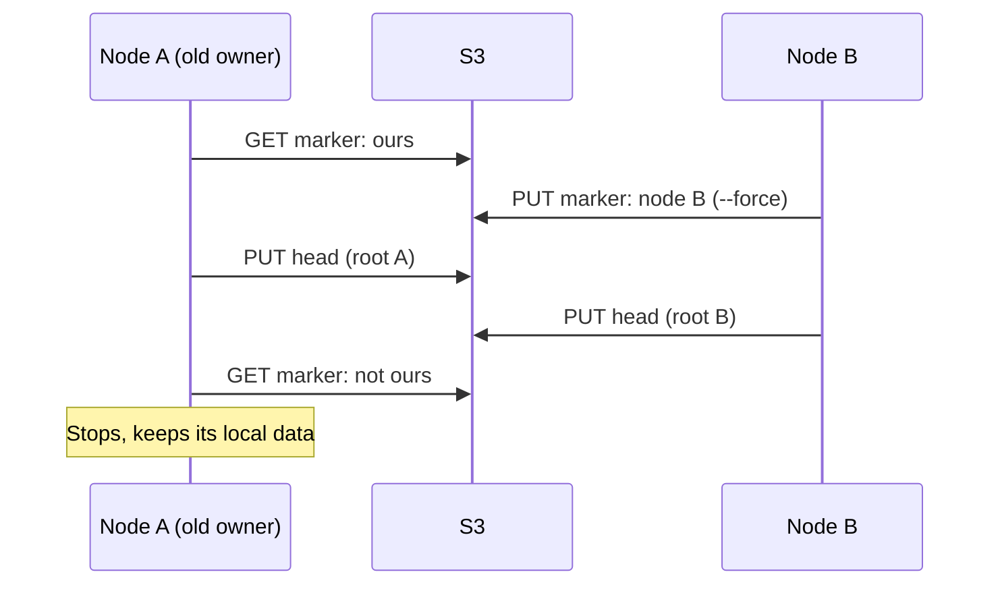

# Reliability

This page states what mica guarantees, what happens in each kind of failure, and why the design keeps data safe. It assumes you know the parts from [architecture.md](architecture.md).

## Guarantees

1. **Flushed data survives a crash of mica or a reboot of the node.** When a guest FLUSH (`fsync`) returns, the data is on the local SSD.
2. **While uploads keep up, data older than about 5 minutes is in S3.** It survives the loss of the node. Uploads have no deadline: on a slow link or with S3 down, unsaved data can grow older, and mica shows the disk as **behind**. With `wait_when_behind = true`, guest writes wait instead, so the bound always holds, at the cost of slow writes.
3. **After a detach, S3 has all the data.** Nothing is lost when a sandbox moves to another node.
4. **mica never deletes local data that S3 does not have.** Only a commit that includes a chunk frees its local copy.
5. **With conditional writes, two nodes cannot both claim a free disk.** A claim is then one atomic create of the marker. Without conditional writes, mica detects a second writer, but does not prevent one. In both cases, the controller must never attach one disk on two nodes, and must use `--force` only for a node that is down. Every attached disk checks its marker every minute and at every commit.
6. **mica never serves corrupt data from S3 or from its cache.** Every downloaded chunk, page and root is checked against its SHA-256. A cache file found at start is checked before its first read.

## What happens when something fails

| Failure | What mica does | Data lost |
|---|---|---|
| The guest crashes | Nothing. Flushed data is on the SSD. | Writes the guest did not flush, as with any disk |
| The mica daemon restarts or crashes | The kernel holds the device's I/O. The new daemon takes the device over from the local files. | None |
| The node reboots or loses power | The devices are gone. At boot, mica uploads the local chunks, then releases the disk, or keeps it for a `mica-mount@` unit. | Writes the guest did not flush |
| The node is lost for good | Another node attaches with `--force` and reads from S3. | About the last 5 minutes while uploads kept up; more if the disk was **behind** |
| S3 is down or slow | Guests keep writing to the SSD. Checkpoints retry every 10 s. After 5 minutes the disk shows **behind**. At the dirty limit, or with `wait_when_behind`, writes wait. | None, while the node lives |
| The network splits, and another node takes the disk | The old node sees the new marker within a minute, or at its next checkpoint. It stops all I/O and keeps its local data as **orphaned**. | The old node's last unsaved writes, kept on its SSD for an operator |
| Two nodes attach one disk at the same moment | With conditional writes, only one create of the marker succeeds. Without them, each writes its marker, waits 1 s and reads it back, and the node that finds another claim backs off. | None |
| A local sync (`fsync`) fails | The disk stops for good: all I/O fails, and its local data is kept. Linux may already have dropped the unsynced pages, so a retry that succeeds would prove nothing. | Possibly the writes of the failed sync; the guest sees an error, not a false success |
| A chunk in S3 is corrupt | The hash check fails, and the read fails with an I/O error. | Nothing is served silently wrong |
| The node loses power during a write | At start, only the chunks that the durable dirty log lists are local. Every other range of the data files is punched out. The next checkpoint compares each listed chunk with its committed hash. Cache files are checked by hash before their first read. | Writes the guest did not flush |
| mica crashes, the node stays up | The kernel holds the device's I/O. The next daemon takes it over. The page cache still has every write, and `recent` lists the chunks that the log does not list yet. | None |
| GC deletes a chunk or page while a checkpoint commits it | The checkpoint sees that a GC ran. Before it writes the head, it waits for that GC to end, checks every new chunk and page, and uploads a missing one again. | None |

## Why each step is in its order

The order of the steps is what makes mica safe without locks in S3.

### A chunk is listed only after its content is in place

- A list never names a chunk whose range holds something other than its content: the copy and the write come first.
- The durable log never names a chunk whose content a power loss can lose: FLUSH syncs the data files first.
- A range that no list names is punched out at the next open. So every range that is not local reads as zeros, and a zero chunk needs no copy.

A write that returned and was not flushed can be lost in a power loss, as on any disk with a write cache. It is not lost in a crash of mica: the page cache still has it, and the `recent` bitmap in `/run` has its chunk's bit. A reboot clears `/run`, and mica also checks the boot ID.

### Tested with power cuts

`lab/bench/crash.sh` drops every write to the data folder at a random moment, with a device-mapper target, then restarts mica as after a reboot and checks every block. A second mode kills only the daemon while the guest writes. In v0.2, 6 runs each on btrfs, XFS and ext4, and 6 daemon kills, lost no write that a FLUSH or FUA had made durable, and the daemon kills lost no write that had returned.

### A commit writes objects that nothing points to, then the pointer

- Chunks, pages and the root are new objects that nothing refers to yet. If mica dies here, the old head still describes a full, consistent disk.
- One PUT of the head switches from one full disk to the next. S3 replaces an object atomically, so a reader sees the old root or the new one, never a mix.
- A chunk counts as saved only after the head is in S3.

### Detach deletes local data before it releases the disk

After a crash, mica finds one of two states:

- **A folder with chunks, and our marker:** the upload was not done. mica uploads it now.
- **A folder without chunks:** S3 has everything. mica releases the marker and deletes the folder.

Chunks without our marker are never uploaded: another node may own the disk now.

### A checkpoint keeps what it uploaded until S3 has every chunk

The guest writes a chunk in place while a checkpoint uploads it. So the checkpoint must still have the uploaded content if a GC deleted the upload. GC can delete it only if a GC was running when the PUT ended. Once a second during the upload, mica reads GC activity: an upload that ended before a read with no GC is safe. Until then, the first write to its chunk keeps a copy, in memory or in the `hold` file. After the head PUT, if a GC ran, the checkpoint checks every committed chunk, and uploads a missing one again, from the data file or the copy. If the check fails, the chunks stay unsaved, and the next checkpoint uploads them again. See [Garbage collection](#garbage-collection) for why an object can go missing.

### Local space is freed only when nothing can need it

A saved chunk leaves the data files only when saved local data is over the disk's cache budget, or the host is short of space. It goes into the cache first. Then the dirty log is rewritten without it: a crash must not bring it back as local. Then mica waits until no read that started earlier can still use its range, and punches the range out.

### A flush keeps its promise, or the disk stops

A flush syncs the changed data files, then the dirty log. If a sync fails, mica does not forget the files, and it stops the disk: all later I/O fails. This also applies to the log rewrites. On Linux, a failed `fsync` can drop the unsynced pages, so a later `fsync` that succeeds proves nothing. An error the guest can see is better than a false success.

### A checkpoint checks ownership just before it commits

The `attached` marker says which node owns a disk. A checkpoint reads it just before the head PUT. If the marker is not ours, the node stops at once:

- It fails all I/O on the device, so the guest sees errors instead of writes that go nowhere.
- It keeps its local chunks and marks the disk **orphaned**. An operator decides what to do with them.

## Fencing

Garage ignores `If-Match` and `If-None-Match`, and Ceph support depends on the version. So mica does not need them. When the store has `If-None-Match` (R2, AWS S3, MinIO, RustFS), set `s3.conditional_writes = true`. Then:

1. **The controller** makes sure that one node owns a disk. mica is not a cluster manager.
2. **The marker** catches mistakes: a missing detach, or a second attach by a script.
3. **A claim is exclusive, or reads back.**
   - With conditional writes, a claim creates the marker only if no marker exists. Of two nodes that claim at the same moment, exactly one succeeds. There is no wait.
   - Without them, a claim writes the marker with a random claim ID, waits 1 s, and reads it back. If two nodes claim at the same moment, the last write wins, and the other node backs off. Both would have to pause more than a second between their first read and their write to both win.
4. **A watcher.** Every attached disk reads its marker once a minute, even when idle. A node that lost its disk stops serving it within a minute.
5. **Full roots** make the remaining races harmless for S3: the head always points to one full disk.

Release is also two requests: read the marker, then delete it. A `--force` claim between the two would lose its marker. This is one more reason for the rule below.

That race: node A passes its marker check, then node B takes the disk with `--force`, then node A writes the head one more time.

For a short time the head may point to node A's root. It is still a full disk, never a mix of two. The rule that prevents even this: **use `--force` only when the old node is powered off or fenced.**

## Integrity

- A chunk's key is the SHA-256 of its plain content. mica decompresses each download and checks it.
- A page's key is the SHA-256 of the plain page. mica checks it after every download, and on every read of its local copy.
- A root's key is the SHA-256 of the file. mica checks it after every download.
- Cache files are written as `.tmp` and renamed, without a sync, so a read never waits for the SSD. A crash can leave a torn cache file. So mica checks the hash of each cache file it finds at start, before the first read from it, and downloads a bad one again. Files that mica wrote in this run are not checked again.

## Daemon restart

A restart pauses I/O for about one second, and loses nothing:

1. On SIGTERM, the daemon runs one last checkpoint for each disk (up to four concurrently, with one 60 s deadline). The guest's I/O is still served during this time. A checkpoint that takes longer runs on, but the daemon stops waiting for it. It never stops in the middle of a chunk.
2. The daemon exits and keeps its devices. The kernel holds new I/O.
3. The new daemon opens each disk from the same local files. Every write mica acknowledged is in their page cache, and the dirty log or `recent` lists its chunk.
4. It takes each device over. The kernel sends the held and in-flight requests again.

Transient recovery failures remain visible as recovering disks and retry every 10 seconds. Their devices stay paused until recovery succeeds.

If no daemon comes back, I/O waits for ever. So `mica.service` uses `Restart=always`, and `mica service stop` refuses while disks are attached.

If a device's disk now belongs to another node, the new daemon deletes the device. Its users get I/O errors instead of waiting for ever.

## Garbage collection

GC deletes chunks, pages and roots that no disk, snapshot or kept checkpoint needs. It must never delete an object that a disk is about to commit.

**The danger.** A checkpoint uploads chunks and pages first and writes the head last. GC can read the head in between. The new objects then look unused.

**The race.** Without conditional writes, GC cannot delete "only if nobody wrote it since I looked". GC checks an object's age, then deletes it. A checkpoint can upload an object with the same hash between those two requests, then commit a head that points to it. This can happen to a chunk and to a page.

**The protections:**

1. **Repair before commit.** The race needs a GC that runs during the checkpoint. A GC writes `gc/last` after its last delete, and before it deletes `gc/lock`. A checkpoint reads `gc/lock`, then `gc/last`, at its start and just before the head PUT. If a GC runs then, the checkpoint waits for it to end, up to 10 minutes. If a GC ran, the checkpoint checks every chunk and page it uploaded, and uploads a missing one again. Only then does it write the head, so a head never names an object that this GC deleted, also after a power cut. A GC that starts after this look finds the new objects young. The checkpoint looks once more after the head PUT, for a checkpoint longer than the grace period. It frees the local copies only when S3 has them all.
2. **Grace period.** GC deletes only objects older than 24 hours. A checkpoint takes minutes, so its new chunks are always young.
3. **The upload rule.** A checkpoint skips the upload of a chunk only when the disk's current root has it at the same place. It uploads any other chunk again, even if S3 may have it. That chunk could be garbage that GC is about to delete. The new upload makes it young again. Pages are always uploaded.
4. **A second look.** Just before each delete, GC reads the object's age again. This makes the race rare; the repair makes it harmless.
5. **Stop on doubt.** If GC cannot read a head, a snapshot, a kept root or a live page, it deletes nothing.
6. **Create from a snapshot** checks that the snapshot still exists after it writes the new head. If the snapshot was deleted meanwhile, the create fails and undoes itself.

In v0.1, we tested the repair with a script that deleted every new chunk right after its upload. The checkpoint found 14 chunks missing after its commit, uploaded them again, and the data read back correctly from S3. In v0.2 the repair runs only after a GC, so this test needs a GC lock or a new `gc/last` during the checkpoint.

**One GC at a time.** The daemon runs one GC at a time. Across nodes, GC creates `gc/lock`. With conditional writes, the create is atomic, so only one GC runs, and a checkpoint that reads no lock knows that no GC runs. Without conditional writes, two GCs can run at once. Each still deletes only garbage, but the first to end deletes the lock while the other may still delete. A checkpoint can then miss the second GC. Use conditional writes when the store has them.

**Short grace periods** (`mica gc --grace 10m`) are for tests. Below 1 hour, GC refuses to run while any disk is attached anywhere.

## Local space

- The dirty chunks of a disk have a limit (20 GiB by default). At 512 MiB, or at half of the limit, a checkpoint starts early. At the limit, new writes wait until a checkpoint frees space. The guest sees a slow disk, not an I/O error.
- Each disk has a clean-cache budget (1 GiB by default), independent of pending writes. A host-wide limit (50 GiB by default) and filesystem headroom safeguard trigger additional eviction. See [storage budgets](operations.md#per-disk-storage-budgets).

## What is not protected

- **Loss of the node's SSD and of S3 at the same time.** S3 is the durable copy.
- **Writes the guest never flushed** before a crash. This is normal disk behavior.
- **The last seconds after a node is lost for good.** Checkpoints run every 30 s, or at 512 MiB of dirty data. So about the last 30 to 60 s are lost while uploads keep up. On a slow link it can be more, up to `max_unsaved_minutes`, unless `wait_when_behind` is on.
- **Two writers, if the controller uses `--force` on a live node, or attaches one disk on two nodes without conditional writes.** mica detects this and stops the old node within a minute.
- **Deleting a disk or snapshot by mistake.** Delete removes the pointer. The data stays in S3 until GC runs, so an operator can recover it by hand before then.
